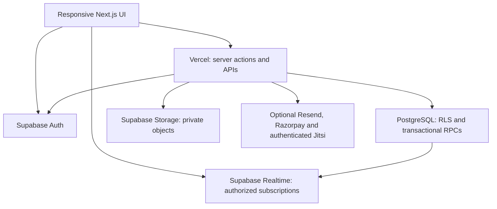
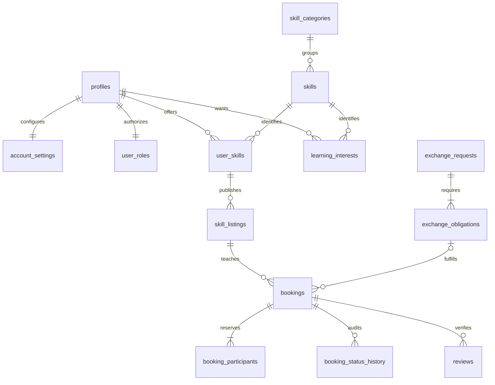
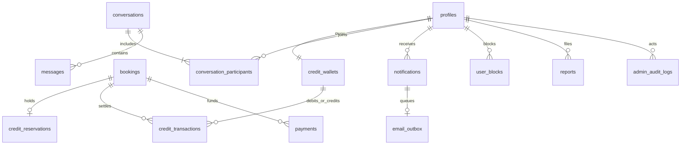

# SkillBridge — architecture and Phase 1 decisions

Status: engineering foundation, not a production-ready application. The foundation migration was applied to a dedicated hosted SkillBridge project and verified for RLS coverage. This document distinguishes shipped foundation code from future workflows.

## Abstract and problem
SkillBridge connects people who can teach complementary skills. Direct swaps remove the need for money, learning credits permit non-reciprocal learning, and optional paid sessions support professional providers. The central engineering problem is keeping identity, access, schedules, exchange obligations and value transfers consistent across concurrent requests.

## Architecture
A modular monolith is appropriate for a solo university project. Next.js handles SSR, forms, server actions and webhook endpoints; PostgreSQL owns authorization and atomic state changes. Splitting into microservices would multiply deployment and transaction complexity without improving the prototype.

Diagram shows target boundaries; only the framework scaffold, client factories, authorization helpers and database foundation exist in Phase 1. Integration traffic is not yet verified. Realtime must not turn Vercel functions into persistent socket servers.

## Source boundaries

| Area | Responsibility | Phase 1 status |
|---|---|---|
| `src/app` | Routes, layouts, server actions, route handlers | Root development screen; remaining page directories reserved |
| `src/components/ui` | Accessible shadcn-compatible primitives | Configuration only |
| `src/domain` | Pure scoring, credit arithmetic, transition graphs | Implemented and unit-tested |
| `src/lib/supabase` | Request-scoped SSR/browser clients | Implemented; hosted Auth not tested |
| `src/lib/auth.ts` | Validate user; check active status and database role | Implemented; hosted integration not tested |
| `src/config/routes.ts` | Complete route/access inventory | Implemented contract |
| `supabase/migrations` | Schema, constraints, indexes, RLS, bootstrap trigger | Executes in isolated PostgreSQL |
| `tests` | Domain and database checks | Actual checks; limitations in verification report |
| `docs` | Architecture, routes, implementation gates | Phase 1 documentation |

Business code never lives in presentation components. Server actions must validate Zod inputs, require a user/admin, enforce resource access, call transactional RPCs and return safe typed errors. A route layout is not sufficient authorization: every action must independently check access. All client-supplied actor IDs and prices are untrusted.

## Data model
The migration contains every required table. Additional tables are justified below:

- `account_settings`: suspension, timezone, onboarding progress, availability policies and preferences stay out of public profiles.
- `exchange_status_history`: exchange transition auditing is distinct from booking history.
- `booking_participants`: conflicts must cover both participants across teaching and learning roles.
- `email_outbox`: notification delivery retries must not roll back successful bookings.
- `booking_meetings`: private meeting references do not appear in public listing/booking projections.

No email addresses or payment details live on public profiles. Auth owns credentials and email. Financial and audit records use restrictive foreign keys: account erasure will anonymize retained records before deleting Auth identity, rather than cascading away the journal.

Diagrams summarize real foreign keys; they do not imply transactional RPCs already exist. The SQL is authoritative for nullable edges and uniqueness.

## Booking and exchange contracts (planned transactional layer)
1. `create_booking`: derive authenticated learner, lock both participant account rows in UUID order, read published listing and active accounts, enforce blocks, time zone rules, notice, duration, exceptions, buffer, daily cap and cancellation policy. Insert booking and BOTH occupied ranges atomically. Reserve credits or initialize payment state in the same transaction. The GiST exclusion constraint is the final race-condition backstop.
2. Requested slots expire after 30 minutes; a worker cancels expired requests and releases holds atomically. Teacher acceptance rechecks expiry. UTC instants are persisted; IANA zones and weekly local wall-clock rules generate slots. Skip nonexistent DST times; show offset-labelled choices for ambiguous times. Rescheduling locks both participants and replaces both slot rows atomically, rolling back completely on conflict.
3. Cancellation is allowed before the captured 24-hour cutoff; teacher cancellations refund a learner in full. Late cancellations, no-shows and disputed sessions need explicit policy/admin resolution. An uncompleted reservation release changes reserved credit only; it is not a second balance refund.
4. `accept_exchange`: verify recipient and pending status, create exactly two reciprocal obligations. Scheduling requires agreement by both users; acceptance alone cannot schedule arbitrary occupied slots. Every obligation must link to the correct exchange participants and offered/requested listing.
5. Completion requires both participants' confirmations after the session end. Opening a meeting never completes a session. Exchange completion requires the number of distinct completed bookings per obligation to meet both promised counts.
6. State changes append immutable histories in the same transaction. Admin dispute resolution requires an audit reason. The TypeScript graphs currently express allowed edges only; SQL actor/time/obligation enforcement is a later phase gate.

## Credit economics and invariants
Policy assumption: **one credit = 15 minutes**, so a 60-minute session costs four credits. No cash redemption, purchase, transfer between arbitrary users, or signup grant. Starting balance is zero. Users can begin with direct swaps; an admin may issue an explicitly audited initial grant. This avoids unlimited credit creation through disposable accounts. Credit cost is derived server-side from duration.

`balance >= reserved >= 0`; spendable balance is `balance - reserved`. Reserve funds on request. Settle only after dual-confirmed completion: lock both wallets in UUID order, verify one held reservation, debit learner, credit teacher, reduce reserved balance, insert exactly one journal transfer and settle the reservation. All steps must share one database transaction. Transfers conserve credits except explicit administrative grants/adjustments. Unique booking settlement and idempotency keys prevent duplicates. Wallet amounts are integer projections of the immutable journal, reconciled regularly.

The migration has balance checks, journal structure, unique settlement, and default-deny writes. It does NOT yet implement reservation/settlement RPCs or guarantee reconciliation for privileged SQL writers. Privileged fixture writes in tests are not examples of production service usage.

## Matching contract
Phase 1 implements the configurable weighted sum only. The candidate query and component derivation are Phase 3 work:

- Skill (40%): candidate's canonical skill ID matches a learning interest; no ambiguous free-text equality.
- Reciprocal (25%): candidate wants at least one skill taught by the current user.
- Availability (15%): overlap minutes / requested session duration, capped at 1, from slots in the next 14 days; unknown availability scores 0 and is labelled unknown.
- Language (10%): any common teaching language.
- Experience (10%): candidate meets requested level; otherwise 0. Policy may later allow partial compatibility.

Candidate retrieval uses indexed interest/skill IDs, prefilters current user, inactive/private/moderated listings, suspended accounts and blocks. Limit to 200 eligible candidates before computing overlap; paginate recommendations. Rank within the requested mode; retain one-way credit/paid alternatives when reciprocal matches are unavailable. Ratings are verified aggregates, not seeded marketing claims. Query plans and production-scale performance remain unverified.

## Security decisions
- RLS is enabled on every application table. Phase 1 grants SELECT only; no end-user writes are currently possible. Future CRUD uses restricted column privileges and `USING` plus `WITH CHECK`, while financial/state operations use audited RPCs.
- Recursive membership policies are avoided with narrowly scoped private-schema lookup functions. Fixed empty search paths prevent object shadowing. The private schema must never be included in exposed Data API schemas.
- User-supplied signup metadata sets display name only. It cannot assign admin roles, suspended status or wallet balances.
- SSR uses per-request clients, signature-validated refresh and no-store responses. Sensitive server paths also call Auth `getUser` and check current account status. No global server client or shared per-user cache.
- No privileged Supabase client exists yet. Optional server secret is reserved for administrative provider integrations; it must never become a `NEXT_PUBLIC_` value.
- Messaging requires membership and active unblocked participants. Admin moderation reads only reported content via a separately audited path; administrators do not receive blanket access to private messages.
- Payment integration remains disabled until raw-body HMAC verification, constant-time comparison, server-side amount/currency/order validation and atomic event deduplication pass sandbox tests. A browser payment-success callback is not proof of payment.
- Resend failures enter an outbox retry flow. Realtime is a delivery hint, not the source of truth; clients reconcile messages and unread counts from authorized queries.
- Upload validation will inspect MIME signature and size, re-encode avatars, reject SVG/executable content, enforce owner-prefixed object paths, and use private buckets with signed reads.
- Public Jitsi rooms are not access-controlled by application login. Use JWT-authenticated deployment or a teacher-managed external meeting with a lobby; do not claim an unguessable room name provides authentication.
- Rate limits, request-origin checks, CSP/nonces, upload policies, Realtime publication, provider adapters and audit retention are required later gates, not completed Phase 1 protections.

## Hosting and operations
Keep Next.js on Vercel; Sites currently uses a different Worker-based hosting runtime. No framework replacement is needed. Use a dedicated Supabase project in Mumbai when available and co-locate server functions. Use separate development/staging/production projects. Apply backwards-compatible migrations before code promotion; backups and restore drills precede destructive schema work. Configure Auth site URL and exact callback allowlists; no arbitrary redirect origins.

GitHub Actions runs typecheck, domain/database tests and the production build. Later add real Supabase integration tests, Playwright multi-user scenarios, provider sandbox tests, accessibility checks and release gates. Do not make a foundation-only deployment look like the completed app.

## Sources checked
- https://nextjs.org/docs/app/getting-started/installation
- https://supabase.com/changelog.md
- https://supabase.com/docs/guides/auth/server-side/creating-a-client
- https://supabase.com/docs/guides/auth/server-side/advanced-guide
- https://supabase.com/docs/guides/database/postgres/row-level-security

Dependency versions come from the registry and are exact-pinned in package.json/package-lock.json; the actual successful build, not a version recommendation alone, is the compatibility check.
